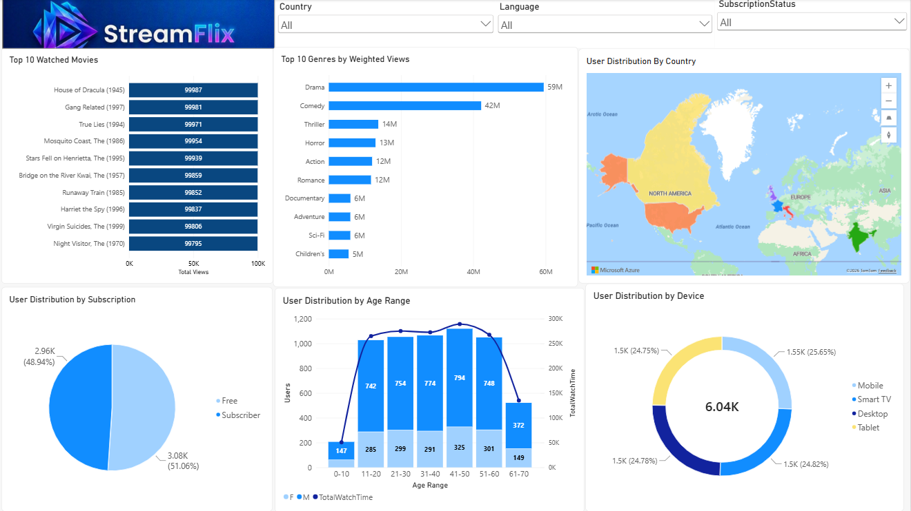

# StreamFlix | Movie Streaming Data Analysis

**Tools:** Power BI, Excel, SQL
**Project Type:** Business Simulation | Personal Portfolio Project
**Industry:** Media & Entertainment | Streaming Services

> StreamFlix is a fictional company and all data is synthetic. This is a business simulation, not an analysis of a real streaming service.



## 📌 Project Overview

StreamFlix is a fictional Italian streaming platform that serves users in six countries. It currently runs a free, ad-supported tier alongside paid subscriptions, and is exploring how to grow its paid subscriber base through a relaunch campaign.

Using three synthetic datasets (Movies, Users and Ratings), I cleaned and explored the data in Excel and built an interactive Power BI report to understand who the audience is, what they watch and how they access the platform.

## 🎯 Business Questions

1. Which movies attract the most views?
2. Which genres are most popular?
3. How are users distributed across countries?
4. How are users split between free and subscriber tiers?
5. How does user activity vary across age groups?
6. Which devices do users use to access the platform?

## 🗂️ Dataset

| File | Description | Rows |
|---|---|---|
| Movies.csv | MovieID, Title, Year, Genres, Language, Country, Total_Views | 3,883 |
| Users.csv | UserID, Age, Gender, Country, SubscriptionStatus, TotalWatchTime, Device | 6,040 |
| Ratings.csv | RatingID, UserID, MovieID, Rating, Timestamp | 10,000 |

The data covers **6,040 users** across **6 countries** (USA, Canada, India, UK, France and Italy).

## 🧹 Data Cleaning

I checked all three tables for missing and duplicate values using Conditional Formatting in Excel. None were found in Movies, Users or Ratings, so Users and Ratings needed no changes.

The Movies table was then cleaned to meet specific client requirements:

- **Untitled film:** MovieID 3936 had no title (only `-1943`), so I replaced it with *The Phantom of the Opera (1943)*.
- **Missing year:** MovieID 16 had `not_def` in place of a year, which I replaced with 1995.
- **New Year column:** I extracted the year from the Title using `=MID(B2,LEN(B2)-4,4)` and pasted it as values.
- **Clean titles:** I removed the year from the Title using `=LEFT(B2,LEN(B2)-6)`, so titles are stored without it.
- **Genre separator:** MovieID 3875 used `--` instead of `|`, which I corrected.
- **Spelling error:** I fixed `Dramma` to `Drama` in the Genres column.

For the genre analysis, I split multi-genre values (such as `Comedy|Drama`) into separate rows in Power Query, then divided each film's views equally across its genres using a DAX measure. This gives each genre a fair share of views, and the genre totals add up to the platform total.

Raw files are kept in `data/raw/` and cleaned versions in `data/cleaned/`, so the original data is never overwritten. The full step-by-step log is in [`docs/data_cleaning_log.md`](docs/data_cleaning_log.md).

## 🔑 Key Insights

| Area | Finding |
|---|---|
| **Content** | Drama is the most-watched genre with 59M weighted views, followed by Comedy (42M) and Thriller (14M). Horror (13M), Action (12M) and Romance (12M) are close behind Thriller. |
| **Devices** | Usage is almost evenly split: Mobile 25.7%, Smart TV 24.8%, Desktop 24.8% and Tablet 24.8%. |
| **Subscriptions** | Of 6,040 users, 51.1% (3,084) are on the free tier and 48.9% (2,956) are subscribers. |
| **Age** | Users range from 9 to 65. Every band from 11 to 60 has over 1,000 users, with the largest at 41-50 (about 1,120). |
| **Gender** | 71.7% of users are male and 28.3% are female, with a similar split in every age band. |
| **Geography** | Canada (1,034), the USA (1,022) and India (1,021) have the most users, but the spread is very narrow: Italy has 1,016, France 986 and the UK 961. |
| **Top movies** | The top 10 movies are separated by only about 0.2% in views (99,795 to 99,987), so the ranking is effectively a tie. This is typical of synthetic data, so I did not base recommendations on it. |

## ✅ Recommendations

1. **Launch in the three largest markets first.** Focus the relaunch on Canada, the USA and India, using promotional pricing to drive paid sign-ups. User numbers are very close across all six countries, so treat this as a sensible starting point for a phased rollout and not a sign that other markets are weak.
2. **Invest in the most-watched genres.** Drama and Comedy lead by a wide margin, with Thriller third. Prioritise new content in these three genres, while noting that Thriller leads Horror by only about 1M views.
3. **Run a multi-device campaign.** Because device usage is nearly even, advertise across all four device types, with slightly more weight on mobile.
4. **Target working-age adults.** Make 25-55 year olds the primary audience. Although the user base is broad, this group is most likely to hold payment methods, while users under 18 are unlikely to be able to subscribe on their own.
5. **Convert the free tier.** Just over half of users (51.1%) are on the free tier, so free-to-paid conversion is the clearest growth opportunity.

## 📊 Power BI Report

| Visual | Question answered |
|---|---|
| [`Top 10 Watched Movies`](images/top10watchedmovies.png) | Which movies attract the most views? |
| [`Top 10 Genres by Weighted Views`](images/top10genresbyweightedviews.png) | Which genres are most popular? |
| [`User Distribution by Country`](images/userDistributionByCountries.png) | Where are users located? |
| [`User Distribution by Subscription`](images/userDistributionBySubscription.png) | What is the free vs. subscriber split? |
| [`User Distribution by Age Range`](images/userDistributionByAgeRange.png) | How do users and total watch time vary by age and gender? |
| [`User Distribution by Device`](images/userDistributionByDevices.png) | Which devices are used to access the platform? |

The report includes slicers for Country, Genre and Device so viewers can explore the data interactively.

## ⚠️ Limitations

- **Genre views are weighted.** Films with several genres have their views split equally between those genres, so genre totals add up to total views. A different weighting method, such as counting a film's full views in every genre, could change the ranking slightly.
- **The data is synthetic.** Patterns such as even device usage may not reflect real user behaviour. Any real business decision would need validated data and further evidence about customer preferences and willingness to pay.

## 🛠️ Tools and Skills

- **Excel:** data cleaning and documentation, including Conditional Formatting to find missing and duplicate values, sorting and filtering, Find and Replace, text      formulas (`MID`, `LEFT`) and the cleaning log
- **Power BI:** interactive dashboards and data visualisation, Power Query to split multi-genre values into separate rows, DAX measures for weighted genre views, data relationships and slicers
- **Analytics:** turning business questions into analysis, finding patterns and presenting insights and recommendations

## 📁 Repository Structure

```
streamflix-analytics/
├── README.md
├── data/
│   ├── raw/                    # original CSV files
│   └── cleaned/                # cleaned CSV files
├── excel/
│   └── Streamflix_Analysis.xlsx
├── powerbi/
│   └── Streamflix_Dashboard.pbix
├── docs/
│   ├── data_cleaning_log.md
│   └── Streamflix_Report.pdf   # exported dashboard
└── images/                     # dashboard screenshots
```

## 📚 Key Learnings

- Translating business questions into analytical questions
- Working with messy synthetic data and documenting cleaning decisions
- Checking recommendations against what the charts actually show
- Recognising the limits of synthetic data when drawing conclusions

## 🔒 Disclaimer

StreamFlix is a fictional company created for educational and portfolio purposes. All data is synthetic and does not represent real customers, transactions or company performance.

This portfolio version shows my individual work. It is based on the same business scenario and core questions as a mock team project completed during the Generation UK&I Data Analytics programme.

---

**Created by:** *[Meena Rawat]*
**Contact:** [LinkedIn](www.linkedin.com/in/meenarawat04) | [Email](mailto:meenarawat04@gmail.com)
